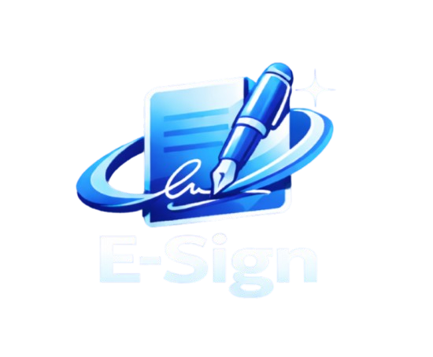

# E-Sign: Sign PDF & Documents

  

  <h3>The Ultimate Privacy-First Flutter Suite for Digital Signatures, PDF Editing & Military-Grade Vault</h3>

  

    
    
    
    
  

---

## 🌐 Live Official Website & Portfolio
Visit the official live landing page and portfolio:  
👉 **[https://ranbirsaini.github.io/e-sign-web/](https://ranbirsaini.github.io/e-sign-web/)**

---

## ⚡ Features
- ✍️ **Multi-Page PDF Signer:** Freehand drawing, saved signatures, stamps, date/initial annotations with smooth vector rendering.
- 🛡️ **AES-256-GCM Secure Vault:** Client-side zero-knowledge encrypted vault for private documents and media.
- 🔄 **Universal Format Conversion:** Convert PDFs to high-res images and images back to clean PDF documents.
- 🗜️ **Smart Image Optimizer:** Target-size JPEG/PNG compression preserving high visual fidelity.
- 🔒 **100% Offline & Private:** Zero document upload, no mandatory login, 100% on-device processing.

---

## 👨‍💻 Developer & Creator
- **Developer:** Ranbir Saini
- **GitHub:** [@Ranbirsaini](https://github.com/Ranbirsaini)
- **Email:** [sainiranbir645@gmail.com](mailto:sainiranbir645@gmail.com)
- **Google Play:** [Ranbir Saini Apps](https://play.google.com/store/apps/details?id=com.e_sign_pr.e_sign_pr)
